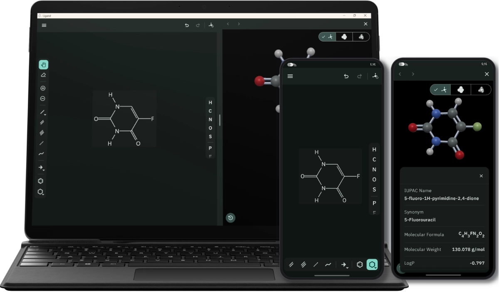

  
  <h1>Ligand</h1>
  <h2>Open-source cross-platform application for sketching, 3D visualizing, and analyzing organic chemistry structure.</h2>

  <a href="#features-">Features</a> &bull;
  <a href="#platform-support-%EF%B8%8F">Platform Support</a> &bull;
  <a href="#download-links-">Download Links</a> &bull;
  <a href="#milestones-">Milestones</a> &bull;
  <a href="#contributing-">Contributing</a> &bull;
  <a href="#contact-">Contact</a> &bull;
  <a href="#license-">License</a>

  
  
  
  

## Features 🌟

- 📦 **Portable & Self-Contained**: Runs without installation from a USB flash drive.
- ✏️ **2D Chemical Sketcher**: Draw skeletal structures with single, double, triple, wedge,
  hashed-wedge, and hydrogen bonds. Fuse rings. Insert benzene, cyclohexanes, and carbon chains.
- 🌐 **3D Visualizer**: Inspect sketched molecules in three rendering modes:
  - **Ball-and-Stick**: CPK-colored spheres and cylinder bonds.
  - **Space-Filling**: Van der Waals radii spheres showing steric hindrance and volume.
  - **Electrostatic Potential Map (EPM)**: Translucent electrostatic potential maps showing charge
    density across the molecular surface.
- 🔤 **Offline Name-to-Structure**: Convert systematic IUPAC names (e.g. _2,2-dichlorobutane_ or
  _alpha-D-glucopyranose_) directly into structures.
- 🧪 **Structure Analysis**: Nomenclate compound. Estimate molecular formula, molecular weight, LogP,
  rotatable bonds, hydrogen bond donors and acceptors.
- ⚠️ **Valence Checking**: Identify valence mistakes in real time with built-in explanation dialogs.
- 📂 **File Import**: Open `.mol` and `.sdf` files directly from local storage.

## Platform Support 🖥️

| Platform    | Supported Versions               |
| :---------- | :------------------------------- |
| **Android** | Android 7.0 (API 24) and above   |
| **Linux**   | Ubuntu, Debian, Fedora, openSUSE |
| **Windows** | Windows 10 and above (x64)       |

## Download Links 📥

- [GitHub Releases](https://github.com/mohammadmansour200/ligand/releases)
- [Ligand Official Website](https://mohammadmansour200.github.io/ligand/)

## Milestones 🎯

- [ ] Rule-based offline structure nomenclature
- [ ] Structure selection, translation, and rotation tool
- [ ] 2D structure export (.mol, .sdf, .png, .svg)
- [ ] 3D model export (.png, .pdb, .xyz, .obj, .gltf)

## Contributing 🤝

Contributions are welcome. Feel free to open an issue or submit a pull request
on [GitHub](https://github.com/mohammadmansour200/ligand).

## Contact 📧

If you have questions or feedback, please reach out:

- **Email:** [mohammadamansour03@gmail.com](mailto:mohammadamansour03@gmail.com)
- **LinkedIn:** [Mohammad Abd Al-Tawab](https://www.linkedin.com/in/mohammadtabdulkader/)

## License 📜

You can use, study, share, and improve it at your will. Specifically you can redistribute and/or
modify it under the terms of
the [GNU General Public License](https://www.gnu.org/licenses/gpl-3.0.html) as published by the Free
Software Foundation, either version 3 of the License, or (at your option) any later version.
